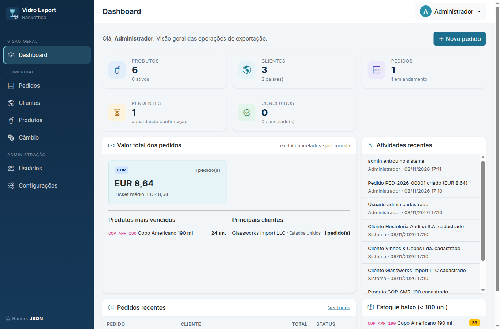
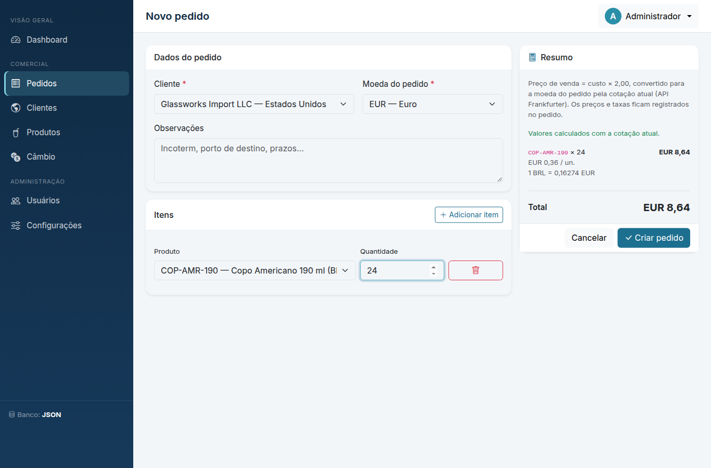
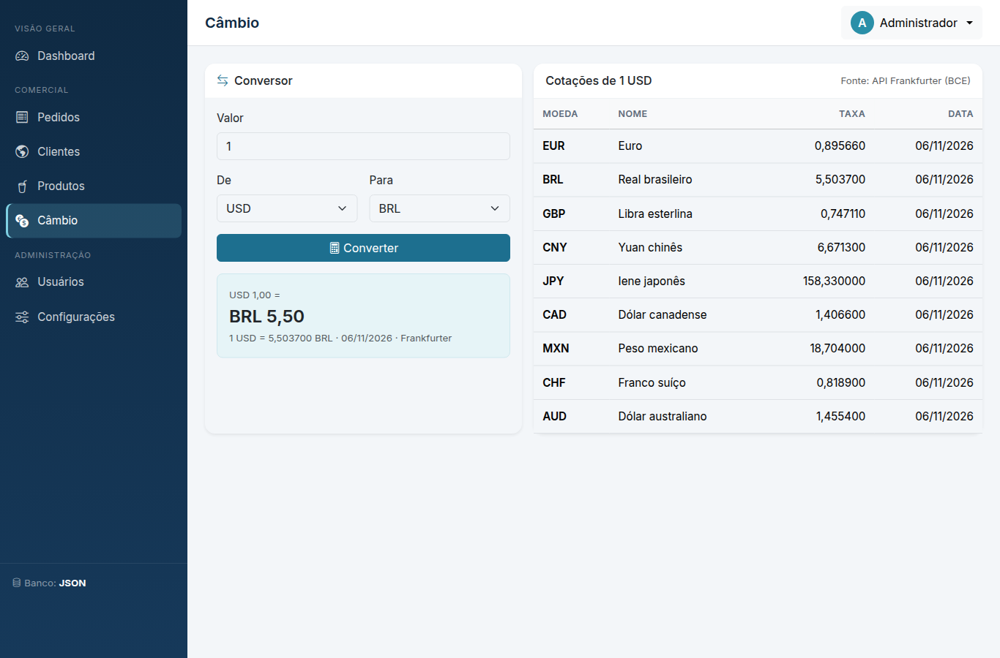
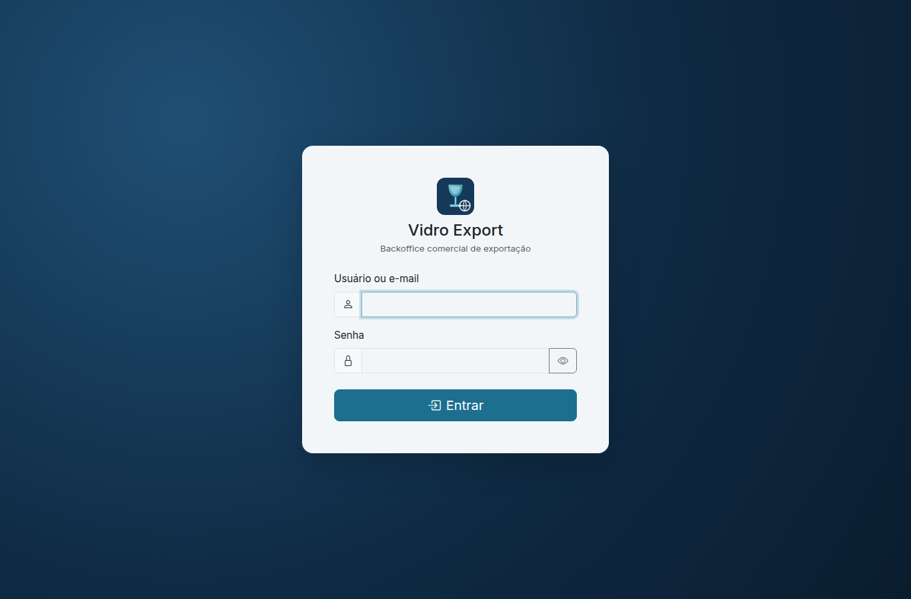
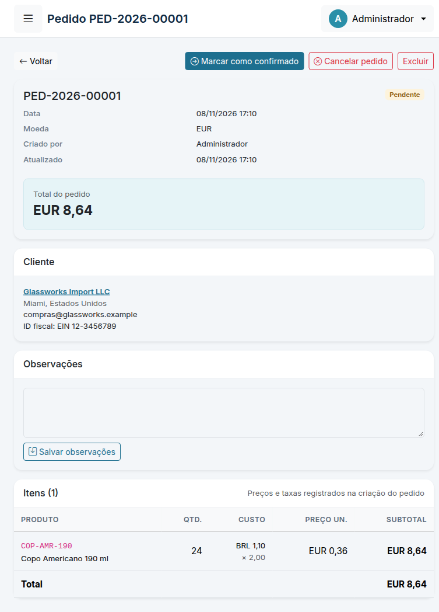
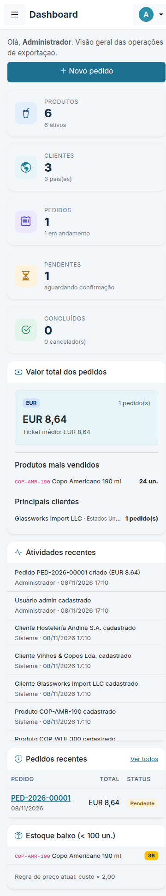

# Vidro Export Backoffice

Sistema web administrativo e comercial de uma empresa que exporta taças e copos de vidro.
Gerencia produtos, clientes, pedidos, usuários e câmbio, com dashboard comercial.

- **Back-end:** Python 3 + Flask (arquitetura orientada a objetos, rotas / serviços / repositórios separados)
- **Front-end:** HTML5, CSS3, Bootstrap 5 e JavaScript puro (Bootstrap e ícones incluídos localmente, funciona offline)
- **Banco de dados:** arquivos JSON locais (padrão, sem instalar nada) **ou** MySQL, trocando só uma linha no `.env`
- **Não usa** Node.js, npm, React, Angular, Vue ou Express.

## Telas

| Dashboard | Novo pedido (cálculo automático com câmbio) |
|---|---|
|  |  |

| Câmbio (API Frankfurter) | Login |
|---|---|
|  |  |

| Pedido no tablet (768px) | Dashboard no celular (375px) |
|---|---|
|  |  |

---

## 1. Funcionalidades

| Módulo | O que faz |
|---|---|
| Login / usuários | Login com sessão, logout, **"Criar conta" na tela de login** (novas contas entram como operador; desative com `ALLOW_SIGNUP=false`), senhas com hash seguro (Werkzeug/PBKDF2-scrypt), perfis **admin** e **operador**, cadastro inicial do 1º administrador, troca de senha, proteção CSRF, API com token JWT (PyJWT). |
| Dashboard | Totais de produtos, clientes e pedidos; pendentes, concluídos, cancelados; valor total por moeda; ticket médio; pedidos por status; produtos mais vendidos; principais clientes; estoque baixo; atividades recentes. Tudo calculado a partir do banco real. |
| Produtos | Cadastro, edição, exclusão, pesquisa e filtros. Código, nome, descrição, custo unitário, moeda, estoque e status. Preço de venda calculado automaticamente: **custo × 2** (multiplicador configurável em *Configurações*). |
| Clientes | Cadastro, edição, exclusão, pesquisa e filtro por país. Razão social, país, cidade, e-mail, telefone, endereço e identificação fiscal. Página de detalhe com histórico de pedidos. |
| Pedidos | Seleção de cliente, vários produtos e quantidades, moeda do pedido, cálculo automático (prévia em tempo real), status (pendente → confirmado → enviado → concluído / cancelado), observações, histórico e filtros. |
| Câmbio | Conversor e tabela de cotações usando a API pública **Frankfurter** (BCE). Se a API falhar, o sistema avisa e **não inventa taxas**. |

### Regras de negócio importantes

- **Preço de venda** = custo unitário × multiplicador (padrão 2, ou seja, 100% sobre o custo), arredondado em 2 casas.
- **Pedidos guardam um "retrato" (snapshot)** de cada item: código, nome, custo, moeda do custo, multiplicador, taxa de câmbio, data da cotação, preço unitário e subtotal. Alterar o produto ou o multiplicador depois **não altera** pedidos antigos.
- Conversão de moeda: se a moeda do pedido for diferente da moeda de custo do produto, a taxa é buscada na Frankfurter no momento da criação. Sem cotação disponível o pedido **não é criado** (mensagem explicativa). Pedidos na mesma moeda funcionam offline.
- **Estoque** é baixado ao criar o pedido e devolvido ao cancelar ou excluir um pedido pendente/confirmado.
- **Integridade:** não é possível excluir cliente ou produto com pedidos; excluir um pedido exclui seus itens; códigos de produto, usuários e e-mails são únicos.
- Não é possível excluir/desativar o último administrador ativo nem o próprio usuário logado.

---

## 2. Instalação e execução no Windows (modo JSON — recomendado para começar)

Pré-requisito: **Python 3.10 ou superior** ([python.org](https://www.python.org/downloads/) — marque *"Add Python to PATH"* na instalação). Recomenda-se abrir a pasta no **Visual Studio Code** e usar o terminal integrado (PowerShell).

1. Extraia o ZIP e entre na pasta do projeto:

   ```powershell
   cd vidro_export_backoffice
   ```

2. Instale as dependências:

   ```powershell
   python -m pip install --user -r requirements.txt
   ```

   > Opcional (recomendado): usar um ambiente virtual
   > `python -m venv .venv` → `.\.venv\Scripts\Activate.ps1` → `python -m pip install -r requirements.txt`

3. Crie o arquivo `.env` a partir do exemplo:

   ```powershell
   copy .env.example .env
   ```

   Confirme que nele está:

   ```env
   DB_MODE=json
   ```

   Recomendado: troque `SECRET_KEY` por uma chave aleatória:

   ```powershell
   python -c "import secrets; print(secrets.token_hex(32))"
   ```

   (Se você não definir, o sistema gera uma automaticamente em `instance/.secret_key`.)

4. Inicie o sistema:

   ```powershell
   python app.py
   ```

5. Acesse no navegador:

   ```text
   http://127.0.0.1:5000
   ```

6. No **primeiro acesso** aparece a tela *"Configuração inicial"* para criar o administrador (senha com no mínimo 8 caracteres, letras e números). Depois disso, a tela de login é exibida normalmente.

7. Outras pessoas podem usar **"Criar conta"** na tela de login. Essas contas já entram liberadas com perfil **operador** (acessam dashboard, produtos, clientes, pedidos e câmbio, mas não Usuários nem Configurações). Um administrador pode promovê-las a admin em *Usuários*. Para desativar o cadastro público, use `ALLOW_SIGNUP=false` no `.env`.

O banco JSON é criado automaticamente em `database/json/` na primeira inicialização.

### Dados de exemplo (opcional)

Para popular com produtos e clientes fictícios:

```powershell
python -m flask --app app seed-demo
```

Também é possível criar administradores pelo terminal:

```powershell
python -m flask --app app create-admin
```

---

## 3. Como funciona o armazenamento JSON

Cada tabela é um arquivo em `database/json/` (`produtos.json`, `clientes.json`, `pedidos.json`, `itens_pedido.json`, `usuarios.json`, `configuracoes.json`, `atividades.json`), com a mesma estrutura das tabelas MySQL:

```json
{ "tabela": "produtos", "versao": 1, "proximo_id": 3, "registros": [ { "id": 1, "codigo": "TAC-BOR-450", ... } ] }
```

Garantias implementadas em `database/repositories/json_repository.py`:

- **Arquivos ausentes ou vazios** são recriados automaticamente com estrutura válida.
- **Gravação atômica:** grava em arquivo temporário, faz `fsync` e substitui com `os.replace` — uma queda de energia nunca deixa um arquivo pela metade.
- **Transações:** operações com várias tabelas (ex.: criar pedido + itens + baixar estoque) são confirmadas juntas; um *journal* (`_transacao.journal`) permite completar na próxima inicialização uma gravação interrompida.
- **Backup automático** (`*.json.bak`) da versão anterior de cada arquivo. Se um arquivo for corrompido (editado à mão, por exemplo), ele é preservado como `*.corrompido-AAAAMMDD...` e restaurado do backup; sem backup, o sistema mostra erro claro em vez de apagar dados.
- **Concorrência:** trava entre threads e entre processos (arquivo `.lock`, funciona no Windows e Linux), IDs únicos e sequenciais.
- **Integridade referencial** igual ao MySQL: `RESTRICT`, `CASCADE` e `SET NULL`, e campos únicos (sem diferenciar maiúsculas/minúsculas).

> Para fazer backup dos dados, basta copiar a pasta `database/json/` com o sistema parado.

---

## 4. Usando MySQL (futuramente)

A aplicação inteira usa a mesma interface `BaseRepository`; trocar de banco **não exige alterar código**.

1. **Instale e inicie o MySQL Server** 8.0+ (Windows: [MySQL Installer](https://dev.mysql.com/downloads/installer/), opção *Server only* ou *Developer Default*). Garanta que o serviço *MySQL80* está em execução (`services.msc`).

2. **Crie o banco com o `schema.sql`** (cria o banco `vidro_export`, tabelas, chaves, índices e configurações padrão):

   ```powershell
   mysql -u root -p < database\mysql\schema.sql
   ```

   Ou, no MySQL Workbench: *File → Open SQL Script* → `database/mysql/schema.sql` → executar (raio).

   Recomendado: crie um usuário próprio para a aplicação (os comandos estão comentados no final do `schema.sql`):

   ```sql
   CREATE USER 'vidro_app'@'localhost' IDENTIFIED BY 'uma_senha_forte';
   GRANT SELECT, INSERT, UPDATE, DELETE ON vidro_export.* TO 'vidro_app'@'localhost';
   FLUSH PRIVILEGES;
   ```

3. **Configure as credenciais no `.env`:**

   ```env
   DB_HOST=localhost
   DB_PORT=3306
   DB_USER=vidro_app
   DB_PASSWORD=uma_senha_forte
   DB_NAME=vidro_export
   ```

4. **Altere** `DB_MODE=json` para:

   ```env
   DB_MODE=mysql
   ```

5. **Inicie novamente** a aplicação: `python app.py`.

Se o MySQL estiver selecionado mas indisponível (serviço parado, senha errada, banco inexistente), a aplicação **não volta silenciosamente para JSON**: o terminal e o navegador mostram uma mensagem clara com a causa. Corrija e reinicie.

### Migrando os dados do JSON para o MySQL

Depois de criar o banco (passo 2) e configurar o `.env` (passo 3):

```powershell
# 1) Apenas valida, sem gravar nada
python -m tools.migrate_json_to_mysql --dry-run

# 2) Migra de fato
python -m tools.migrate_json_to_mysql
```

O script:

- valida os arquivos JSON antes de começar: **IDs duplicados**, **valores únicos repetidos** (código de produto, usuário, e-mail) e **referências quebradas** (pedido sem cliente, item sem produto etc.). Se encontrar problemas, lista todos e não grava nada;
- **preserva os IDs** originais, mantendo todos os relacionamentos;
- grava tudo em **uma única transação**: se algo falhar, nada fica pela metade;
- **previne duplicações:** se o MySQL já contém registros com os mesmos IDs, o script para e avisa (código de saída 3). Use `--skip-existing` para importar apenas o que ainda não existe;
- `--json-dir CAMINHO` permite indicar outra pasta de origem.

Depois, altere `DB_MODE=mysql` e reinicie. Os arquivos JSON não são modificados (servem de backup).

---

## 5. API (opcional)

Autenticação por token JWT:

```http
POST /api/token          {"username": "admin", "password": "..."}   → {"token": "..."}
GET  /api/produtos       Authorization: Bearer <token>   (aceita ?q=)
GET  /api/clientes       Authorization: Bearer <token>
GET  /api/pedidos        Authorization: Bearer <token>   (aceita ?status=)
GET  /api/pedidos/<id>   Authorization: Bearer <token>
POST /api/pedidos        {"cliente_id": 1, "moeda": "USD", "itens": [{"produto_id": 1, "quantidade": 10}]}
```

---

## 6. Testes automatizados

```powershell
python -m pytest
```

Cobrem: inicialização do Flask, login/logout, credenciais inválidas, proteção de rotas e perfis, CSRF, JWT, CRUD de produtos/clientes/usuários, pedidos (cálculo, conversão, snapshot, estoque, status, exclusão), integridade referencial, filtros, dashboard, cálculo de preços, câmbio (incluindo falha da API), persistência após reinício, arquivos vazios/corrompidos, journal de transação e gravações simultâneas.

Os testes não acessam a internet (a API de câmbio é simulada) e **não precisam de MySQL**: os testes MySQL são ignorados automaticamente. Para executá-los num banco de testes isolado (o banco é **apagado e recriado** a cada teste, por isso o nome precisa terminar em `_test`):

```powershell
$env:MYSQL_TEST_HOST="127.0.0.1"
$env:MYSQL_TEST_PORT="3306"
$env:MYSQL_TEST_USER="root"
$env:MYSQL_TEST_PASSWORD="sua_senha"
$env:MYSQL_TEST_DATABASE="vidro_export_test"
python -m pytest
```

Os mesmos testes de contrato rodam nos dois repositórios (JSON e MySQL), garantindo comportamento idêntico.

---

## 7. Estrutura do projeto

```text
vidro_export_backoffice/
├── app.py                  # fábrica Flask, segurança, erros, comandos CLI
├── config.py               # leitura do .env
├── requirements.txt / .env.example / README.md
├── database/
│   ├── __init__.py         # escolhe o repositório pelo DB_MODE (sem fallback)
│   ├── schema_def.py       # definição lógica das tabelas (comum a JSON e MySQL)
│   ├── exceptions.py
│   ├── json/               # arquivos JSON (criados automaticamente)
│   ├── mysql/schema.sql
│   └── repositories/       # base_repository.py, json_repository.py, mysql_repository.py
├── models/                 # Product, Client, Order, OrderItem, User
├── services/               # PriceCalculator, ExchangeService, OrderService, Product/Client/User/Dashboard/Settings...
├── routes/                 # blueprints: auth, dashboard, products, clients, orders, users, exchange, settings, api
├── templates/              # base.html + telas (auth/, products/, clients/, orders/, users/, exchange/, errors/)
├── static/                 # css/, js/, images/, vendor/ (Bootstrap 5 e Bootstrap Icons locais)
├── tools/                  # migrate_json_to_mysql.py, seed_demo.py
└── tests/
```

## 8. Configurações do `.env`

| Variável | Padrão | Descrição |
|---|---|---|
| `DB_MODE` | `json` | `json` ou `mysql` |
| `JSON_DATA_DIR` | `database/json` | pasta dos arquivos JSON |
| `DB_HOST`, `DB_PORT`, `DB_USER`, `DB_PASSWORD`, `DB_NAME` | — | conexão MySQL |
| `ALLOW_SIGNUP` | `true` | exibe "Criar conta" na tela de login (contas de operador) |
| `SECRET_KEY` | gerada em `instance/` | chave de sessões e tokens |
| `EXCHANGE_API_URL` | `https://api.frankfurter.dev/v1` | API de câmbio |
| `EXCHANGE_TIMEOUT` | `8` | tempo limite (s) da API de câmbio |
| `HOST`, `PORT` | `127.0.0.1`, `5000` | endereço do servidor |
| `FLASK_DEBUG` | `false` | modo debug (apenas desenvolvimento) |

## 9. Solução de problemas

- **`python` não é reconhecido:** reinstale o Python marcando *Add Python to PATH*, ou use `py` no lugar de `python`.
- **Porta 5000 ocupada:** altere `PORT=5001` no `.env`.
- **"Banco de dados indisponível" com MySQL:** verifique se o serviço está ativo, as credenciais do `.env` e se o `schema.sql` foi executado.
- **"Cotação indisponível":** sem internet ou API Frankfurter fora do ar. Pedidos na mesma moeda do custo continuam funcionando.
- **Esqueci a senha do administrador:** crie outro admin com `python -m flask --app app create-admin`.
